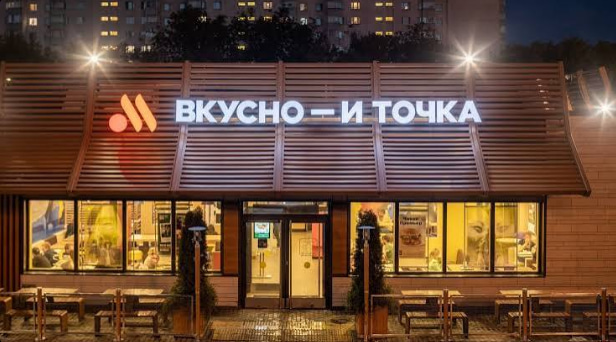
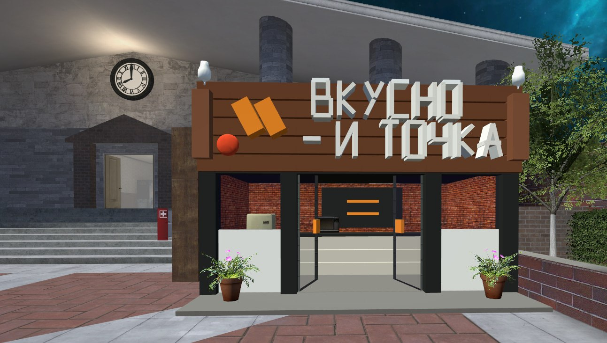
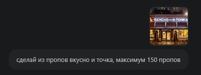
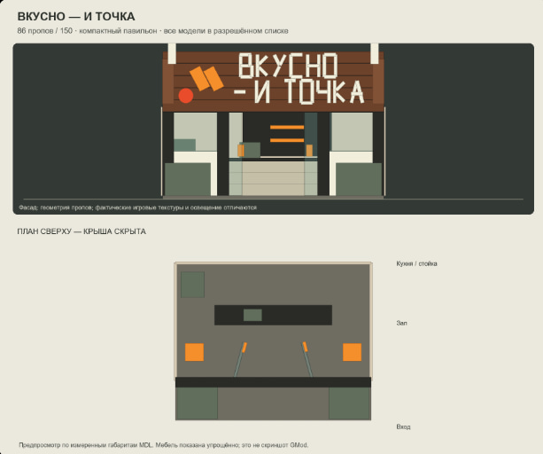

# advdupe2-mcp

**Строй в Garry’s Mod по описанию и фотографии.**

MCP-сервер, который позволяет ассистенту собирать постройки из пропов и сохранять их для **Advanced Duplicator 2**. Задай референс, размер и лимит пропов — затем загрузи готовый дюп в игре.

## Пример: от фотографии до постройки

Запрос: **«Сделай из пропов Вкусно — и точка, максимум 150 пропов»**.

<table>
  <tr>
    <th width="50%">Референс</th>
    <th width="50%">Результат в Garry’s Mod</th>
  </tr>
  <tr>
    <td></td>
    <td></td>
  </tr>
</table>

После уточнения размера получился компактный павильон на **86 пропов**: вывеска, логотип, стеклянные двери, стойка, мебель и растения. Справа — реальный игровой скриншот; окружающие здания относятся к карте.

<details>
<summary>Запрос и схема постройки</summary>

**Сообщение ассистенту:**



**Фасад и план сверху перед загрузкой:**



Схема показывает габариты и расположение деталей. Текстуры и освещение видны на игровом скриншоте выше.

</details>

[JSON этой постройки](builds/vkusno_i_tochka_small/build.json) · [Генератор](builds/vkusno_i_tochka_small/generate.py)

## Что умеет

- Создавать здания, фасады, интерьеры, мебель и декор из `prop_physics`.
- Подбирать модели из разрешённого списка сервера и читать их размеры.
- Задавать позиции, углы, цвета, материалы, скины и соединения `Weld` / `NoCollide`.
- Проверять постройку перед сохранением через `preview_only`.
- Читать и записывать AdvDupe2 ревизий **4 и 5**, сохранять структуру в JSON.
- Переносить и поворачивать простые готовые постройки.

Сервер работает локально через **stdio**. Ассистент создаёт файл дюпа, а игрок загружает его через Advanced Duplicator 2.

## Установка

Нужны **Python 3.11+**, **Garry’s Mod**, **Advanced Duplicator 2** и MCP-клиент. Для работы по фотографиям ассистент должен поддерживать изображения.

```powershell
python -m venv .venv
.\.venv\Scripts\python.exe -m pip install -e .
Copy-Item mcp.config.example.json mcp.config.json
```

В `mcp.config.json` замени пути на свои и добавь блок `mcpServers` в настройки клиента:

```json
{
  "mcpServers": {
    "adv2mcp": {
      "command": "C:/projects/advdupe2-mcp/.venv/Scripts/python.exe",
      "args": ["-m", "adv2mcp"],
      "env": {
        "ADV2MCP_DUPE_DIR": "D:/SteamLibrary/steamapps/common/GarrysMod/garrysmod/data/advdupe2",
        "ADV2MCP_REQUIRE_ALLOWLIST": "1",
        "ADV2MCP_REVISION": "4"
      }
    }
  }
}
```

Локальный конфиг исключён из Git. `run.ps1` использует его настройки; при прямом запуске Python задай переменные окружения самостоятельно.

## Разрешённые модели

Перед сохранением постройки MCP проверяет профиль сервера. Импортируй Lua-файл или текст со списками `Props`, `NewProps`, `Whiteprop`:

```powershell
.\run.ps1 import-props props.lua
```

Lua-код не выполняется. Профиль сохраняется в `advdupe2/adv2mcp/server-props.json` и перечитывается без перезапуска MCP. Для ручного списка есть [пример JSON](profiles/server-props.example.json).

По умолчанию запись без профиля заблокирована. Наличие модели на диске не гарантирует разрешение её спавна: права и лимиты задаёт игровой сервер.

## Использование

Прикрепи фотографию и напиши ассистенту, например:

> Построй небольшой ресторан по этому фото. Максимум 150 пропов, только разрешённые модели. Добавь открытый вход, стойку и два столика. Сохрани как `mcp/restaurant.txt`.

После сохранения открой **Advanced Duplicator 2 → mcp → restaurant** и поставь постройку.

Доступен и CLI:

```powershell
.\run.ps1 list
.\run.ps1 inspect mcp/restaurant.txt
.\run.ps1 build examples/wall.json mcp/wall.txt
.\run.ps1 decode mcp/restaurant.txt restaurant.json
.\run.ps1 encode restaurant.json mcp/copy.txt
```

## Инструменты MCP

| Инструмент | Назначение |
|---|---|
| `get_status`, `get_prop_policy` | Настройки и разрешённые модели |
| `search_models`, `model_info` | Поиск моделей и их габариты |
| `list_dupes`, `inspect_dupe` | Файлы и состав построек |
| `create_build` | Проверка и создание постройки |
| `read_dupe`, `write_dupe` | Чтение и изменение структуры дюпа |
| `transform_dupe` | Поворот и перенос постройки |

В [builds/](builds/) находятся другие примеры: казино, ресторан OLIVA, дом и рабочее место с ПК. Для них нужны соответствующие модели и профиль разрешений.

## Ограничения

Каталог индексирует базовые VPK и распакованные аддоны; Workshop `.gma` и внешние игровые монтирования не индексируются. Примеры с водой, подсветкой и автоматами используют декоративные пропы. Спавн и физику нужно проверять в игре.

## Разработка

```powershell
.\.venv\Scripts\python.exe -m pip install -e '.[dev]'
.\.venv\Scripts\python.exe -m pytest -q
```

Для генерации схем предпросмотра установи `pip install -e ".[examples]"`.

## Лицензия

Код проекта — [MIT](LICENSE), © 2026 Vodeninja.

Тестовый файл `tests/fixtures/upstream_sh_codec.lua` взят без изменений из [wiremod/advdupe2](https://github.com/wiremod/advdupe2), автор — emspike, коммит `e3ffa3c5d772658a11eacfb8570d543636392f9c`. Для него действует отдельная [Apache License 2.0](tests/fixtures/UPSTREAM_LICENSE). Игровые модели и текстуры в репозиторий не входят.
